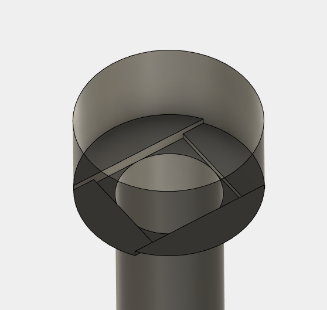
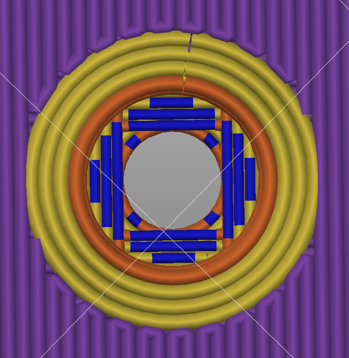

# Counterbore Bridging

An Autodesk Fusion add-in that makes counterbores printable without support on FDM 3D printers.

[中文文档](README_zh.md)

When a counterbore faces the print bed, the ring around the hole has nothing to print on. The usual fix is "sacrificial bridging": a few layer-high cuts above the counterbore floor, so that each layer can bridge from wall to wall. The first cut is a strip as wide as the hole, the next one turns by 90° (or by 60° for a hex hole), and the last one ends on the hole outline. The slicer then prints straight bridges instead of drooping loops.

This add-in creates those cuts as a single **Counterbore Bridge** feature in the timeline. You can edit it like any other feature, and it follows changes to the model.

## Features

- Works with any hole shape: round, hex, square, slots, or several holes in one counterbore.
- Picks the number of cuts from the hole: one per straight-edge direction (a hex hole gets 3, a square or slot 2, a round hole 2). You can also set the number yourself.
- Cuts follow the hole's edges, or a reference edge, sketch line or axis that you pick, plus an optional angle.
- Works on bodies in components and nested components, in any orientation.
- Layer height and angle are model parameters, so you can link them to your own user parameters (e.g. `layer_height`).
- Double-click the feature in the timeline to change any setting, including the selected counterbores.
- English, German, Simplified and Traditional Chinese, following Fusion's language setting.

## Installation

1. Download this repository (green **Code** button → **Download ZIP**) and unpack it, or clone it.
2. Put the folder into Fusion's add-in folder and make sure it is named exactly `CounterboreBridging` (a ZIP download unpacks as `CounterboreBridging-main`, rename it):
   - Windows: `%appdata%\Autodesk\Autodesk Fusion 360\API\AddIns`
   - macOS: `~/Library/Application Support/Autodesk/Autodesk Fusion 360/API/AddIns`
3. Restart Fusion. The add-in starts automatically; if not, start it under **Utilities → Add-Ins → Scripts and Add-Ins**.

## Usage

1. In the **Design** workspace, open **Solid → Modify → Counterbore Bridge**. To pin it to the toolbar, use the ⋮ next to the menu entry.
2. Select one or more **counterbore floors**: the flat face with the hole in it.
3. Optionally adjust:
   - **Reference**: a straight edge, sketch line or construction axis for the first bridges. Without one, the bridges follow the hole's own edges.
   - **Angle**: rotates the bridges away from the reference. Without a reference it only affects round holes and manual layer counts; otherwise it is greyed out.
   - **Layer height**: your slicer's layer height (default 0.2 mm). Accepts expressions and user parameters.
   - **Layers from hole shape**: on by default. Turn it off to set the number of layers yourself.
4. Click **OK**. Each selected body gets one Counterbore Bridge in the timeline.

To change it later, double-click the feature in the timeline, or edit its parameters in **Modify → Change Parameters**.

## Notes and limitations

- The feature uses Fusion's Custom Feature API, which Autodesk still marks as a preview. It has been reliable in testing, but a future Fusion update could change its behaviour.
- The counterbore walls should be perpendicular to the floor.
- If the add-in is not loaded, Fusion keeps the existing geometry but cannot recompute the feature, and shows a warning on it.
- If a counterbore changes too much upstream (for example, it is moved to another place), the feature can no longer find it and turns red. Double-click it and select the floor again.

## Development

- `commands/counterboreBridge/geometry.py` builds the cut as a single body from boolean operations; `feature.py` wraps it in the custom feature; `entry.py` has the create and edit commands; `strings.py` the translations.
- `dev/fusion_tests.py` is a regression test that runs inside Fusion. It builds test parts in a new, unsaved document (including rotated parts, components and every hole shape), creates and edits bridges, and checks the results. Run it inside Fusion with `app` and `adsk` in scope (for example from the Text Commands window in Python mode); failures end up in `result["failures"]`.
- `dev/reload.py` reloads the add-in in a running Fusion. Note that the timeline icon only changes after a Fusion restart.
- `dev/make_icons.py` renders the icons (pure Python, no dependencies).

## Credits

Thanks to [Rarder44](https://github.com/Rarder44) for support for non-circular counterbores, [kap1bala](https://github.com/kap1bala) for the Chinese translation, [BenRoe](https://github.com/BenRoe) for the macOS instructions, and [luxflow](https://github.com/luxflow) for tracking down the component bug.
